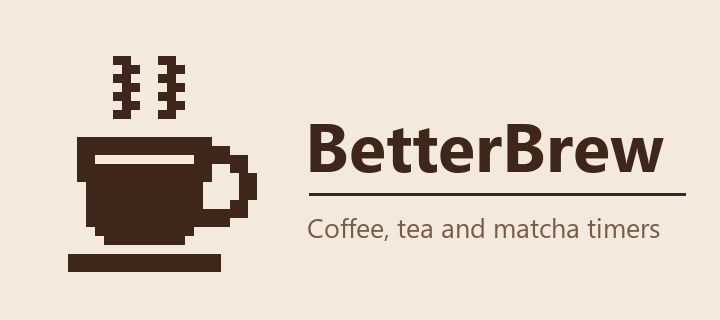
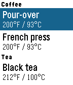
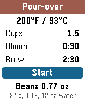
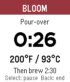
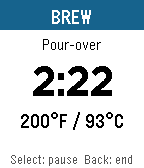
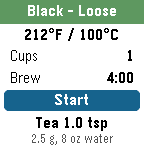

<p align="center">
  
</p>

A simple, no-frills brew timer for the Pebble Time (basalt), written in C with the Pebble SDK.

<p align="center">
  
  
  
  
  
</p>

## Drinks

- **Coffee:** Pour-over and French press, each with a bloom stage followed by a brew stage
- **Tea:** Black, Green, Oolong and Herbal, each as Loose leaf or Teabag
- **Matcha:** a short 30-second timer

Every drink shows its water temperature in °F and °C.

## Using it

- Pick a drink. Teas ask for Loose leaf or Teabag first.
- On the setup screen, Up/Down move between rows (Cups, Bloom, Brew, Start). Select on a row edits it: Up/Down change the value (hold to speed up), Select or Back finishes. Select on **Start** begins the timer; holding Select starts it from any row.
- Cups sets the brew size (half-cup steps, 8 oz per cup). The screen shows how much to use: coffee beans, loose tea or matcha by weight and teaspoons, or the number of teabags.
- Coffee bloom can be set up to 5 minutes. Your times and sizes are remembered per drink.
- During a timer, Select pauses and resumes. Bloom moves on to brew automatically, with a vibration at the end of each stage and when brewing is done. Back ends the timer.

The timer stops if you leave the app.

## Building

Requires the [Pebble SDK](https://developer.repebble.com/sdk/) (Linux, macOS, or WSL on Windows).

```sh
pebble build
pebble install --emulator basalt
pebble install --phone <phone-ip>    # watch via the Pebble app's Developer Connection
```

Each [release](https://github.com/Perlsowisdom/BetterBrew/releases) has a ready-to-install `.pbw` file attached.

## Project layout

```
src/c/BetterBrew.c               app source
resources/images/menu_icon.png   launcher icon
package.json                     project metadata
docs/                            README images
```
